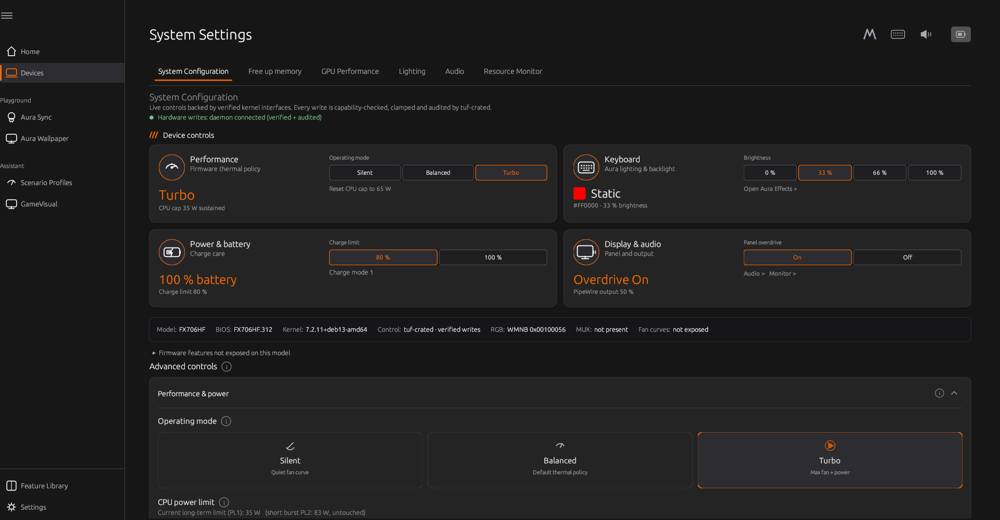
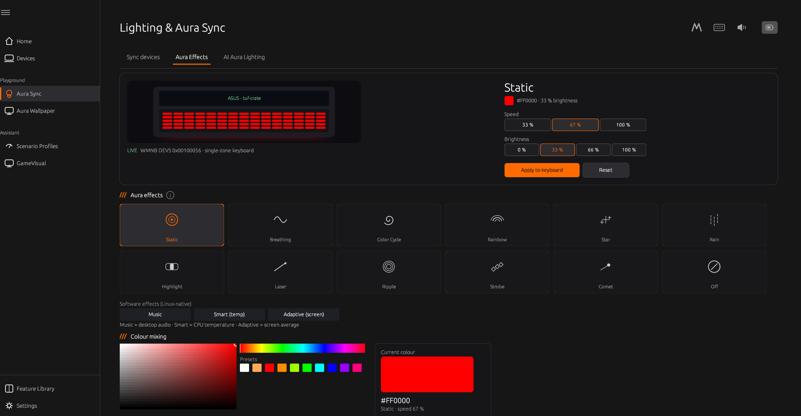
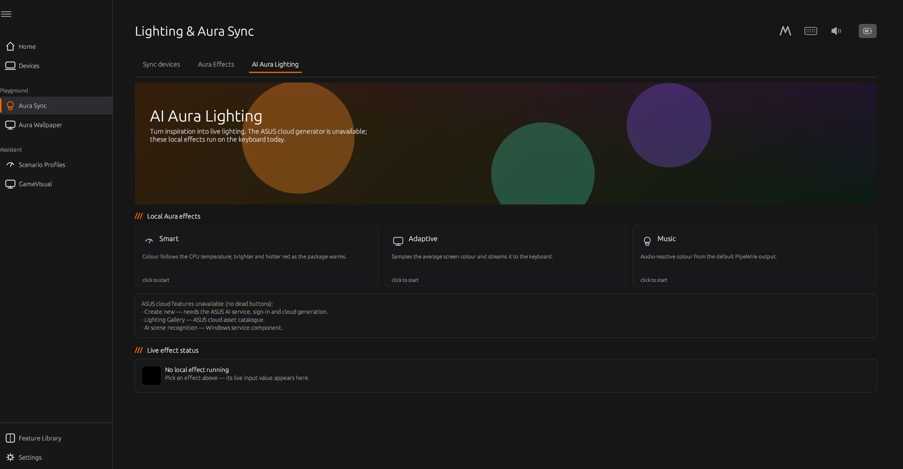
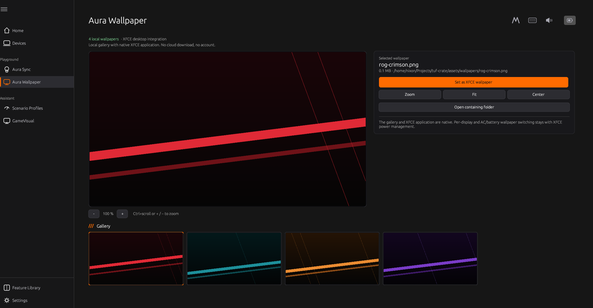
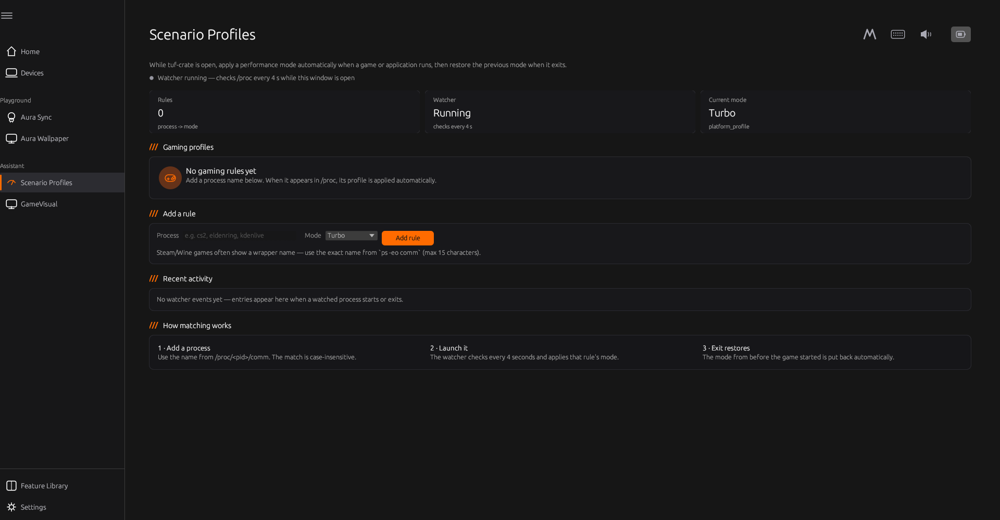
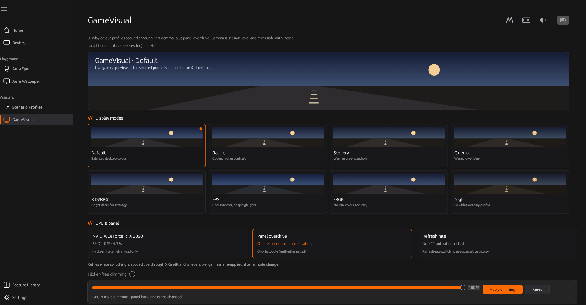
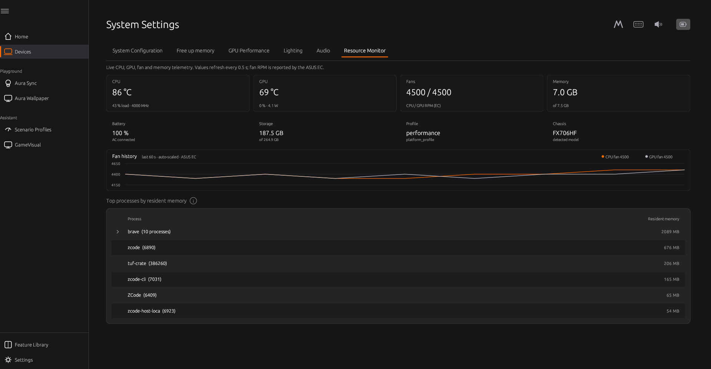
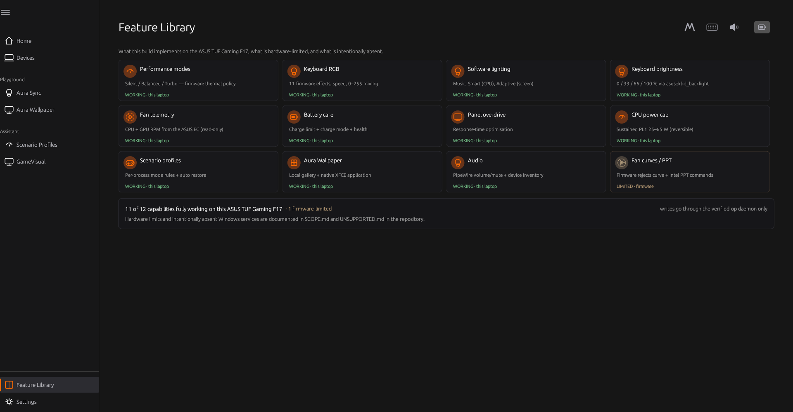

# tuf-crate — Armoury-Crate-equivalent control center for ASUS TUF FX706HF (Linux)

A native Linux application recreating the **hardware-management capabilities** of ASUS
Armoury Crate for the TUF Gaming F17 FX706HF, built exclusively on kernel-sanctioned
interfaces, with hardware safety as the primary design constraint.

```
tuf-crate      # GUI: dashboard, performance profiles, fans/thermals, battery,
               #      lighting, display & GPU — capability-driven, monitoring-first
tuf-crate-cli  # strictly read-only status (JSON or text)
```

## Pictures

The whole shell follows the Armoury look — dark palette, accent orange, animated
sidebar, info popovers, hover/focus states everywhere. (The Home hero render and the
Settings theme previews are official ASUS artwork that stays local-only —
`assets/vendor-reference/` is gitignored — so they are intentionally not shown here.)

**System Settings — live device controls** (profiles, keyboard, battery care, panel
overdrive; every write clamped + audited by `tuf-crated`):



**Lighting & Aura Sync — keyboard effects, speed/brightness, colour mixing:**



**AI Aura Lighting — Linux-native Smart / Adaptive / Music effects with live status:**



**Aura Wallpaper — local gallery with zoom (+/−, drag-pan, Ctrl+scroll) and native
XFCE application:**



**Scenario Profiles — per-process performance rules with a live watcher activity log:**



**GameVisual — display profiles, panel overdrive, refresh-rate switching,
flicker-free dimming:**



**Resource Monitor — CPU/GPU/fan/memory telemetry with fan history:**



**Feature Library — what works on this laptop, what is firmware-limited:**



## What it controls (all clamped, capability-gated, audited)
- Silent / Balanced / Performance (Turbo) — `platform_profile`
- Battery charge limit 20–100 % — `charge_control_end_threshold`
- Keyboard backlight — `asus::kbd_backlight`
- Keyboard RGB static colour + 11 effects + speed — upstream `kbd_rgb_mode` (verified live)
- Software effects — Music (audio-reactive), Smart (CPU-temp), Adaptive (screen-average)
- ASUS hotkeys — Fn+F5 profile cycle and keyboard-brightness keys while tuf-crate runs
- Keyboard backlight inactivity timeout with automatic restore
- Flicker-free software dimming (GPU output, panel backlight unchanged)
- Gaming profiles — auto-apply a performance profile while a chosen process runs
- AC/battery profile switching — automatic Silent/Turbo per power source
- Panel overdrive — `panel_od`
- dGPU mode — Standard restore is safe; **live Eco disable is blocked** because this EC can freeze the compositor. Boot-time switching is not installed yet.
- CPU sustained power cap 25–65 W — `intel-rapl` (user-authorized; lowers heat; resets on reboot)

## What it monitors
CPU package / NVMe / ACPI-zone temps · cpu_fan & gpu_fan RPM · GPU temp/util/power/
perf-state/throttle-reasons · battery capacity/health/threshold/AC · charge mode ·
firmware-attributes inventory · detected capability set.

## What it refuses (with firmware-level evidence)
AI Aura (Windows AI service), custom fan curves, manual PWM,
WMI power limits, Dynamic Boost control — see `docs/UNSUPPORTED.md`.

## How controls work (privileged daemon)
`scripts/install.sh` installs a root systemd service (**tuf-crated**) that exposes exactly the
verified operations over a local socket — the same privileged-daemon pattern as asusd and
power-profiles-daemon. The GUI detects it automatically: **controls work out of the box**, no
CLI flags. Every daemon write is closed-enum, clamped, capability-gated and audited
(`/var/lib/tuf-crate/audit.jsonl`). Without the daemon the app stays monitoring-only.

**Fans**: switching Silent/Balanced/Performance drives the firmware's own thermal policy —
measured live on the FX706HF: ~4000 RPM (balanced) → ~4400 RPM (performance) within seconds,
auto-ramping to 5500 RPM under sustained load. Custom per-temperature fan curves remain
unsupported by this model's firmware (see `docs/UNSUPPORTED.md`). Settings (profile, power
cap, fan mode) can be persisted across reboots from the GUI ("24/7 persistence").

## Status (verified on the target machine)
- 43/43 tests · clippy 0 warnings · `cargo audit` 0 vulnerabilities (324 deps)
- Live-verified on FX706HF: profiles, fans, battery health/threshold, NVIDIA telemetry, firmware-attributes, **keyboard static RGB (red/green/blue/amber)**
- Full UI walkthrough (all 7 tabs + every interactive flow) on an isolated virtual display — see `docs/UI-VERIFICATION.md`
- Requirement-by-requirement compliance with the original Armoury-Crate-recreation goal: `docs/REQUIREMENTS-COMPLIANCE.md`

## Documentation
| Doc | Content |
|---|---|
| `docs/RESEARCH.md` | Armoury Crate protocol research (WMNB/DEVID inventory from this machine's DSDT) |
| `docs/COMPATIBILITY.md` | Feature × interface matrix |
| `docs/SAFETY.md` | Binding safety policy and enforcement |
| `docs/RGB.md` | Keyboard RGB protocol: effects, speed, mixing, verification |
| `docs/GAMING.md` | Per-game automatic performance profiles |
| `docs/SCOPE.md` | Feature-parity definition of done + explicitly closed items |
| `docs/ARCHITECTURE.md` | Design, write funnel, test seam |
| `docs/COMPARISON.md` | Feature-by-feature Armoury Crate comparison |
| `docs/UNSUPPORTED.md` | Unsupported features and the evidence for each |
| `docs/ASUS-LINUX-FEATURE-RESEARCH.md` | What asusctl/supergfxctl/ghelper use, and what is portable here |
| `docs/INSTALL.md` | Install/uninstall/backup/restore |
| `docs/REQUIREMENTS-COMPLIANCE.md` | original goal → artifact mapping |
| `docs/DEPENDENCY-AUDIT.md` | cargo audit results |
| `docs/UI-VERIFICATION.md` | UI walkthrough + bug-audit record |
| `docs/WINDOWS-STACK.md` | Windows ASUS component inventory vs Linux |

## Development
```
cargo test --workspace     # 43 tests — fixture-based, never touches hardware
cargo clippy --workspace   # zero-warning policy
cargo build --release -p tuf-gui
tuf-crate --mock           # develop the GUI against the simulated machine
```

---

## 🎨 Keyboard RGB — WORKING from Linux (verified 2026-11-01)

Keyboard colour control now works natively, through the **upstream kernel** interface — the
same WMNB `DEVS` call every other ASUS attribute uses:

```
/sys/class/leds/asus::kbd_backlight/kbd_rgb_state   "1 1 1 0 0"  (enable engine)
/sys/class/leds/asus::kbd_backlight/kbd_rgb_mode    <cmd> <mode> <r> <g> <b> <speed>

cmd = 1 → 0xb4 (set), 0 → 0xb3
mode: 0 Static · 1 Breathing · 2 Color Cycle · 3 Rainbow · 4 Star · 5 Rain ·
      6 Highlight · 7 Laser · 8 Ripple · 10 Strobe · 11 Comet
r/g/b = 0–255 each (arbitrary mixing)     speed = 0/1/2 → 33 / 67 / 100 %
```

The keyboard power-state command (`kbd_rgb_state = "1 1 1 0 0"`) is required for the
firmware to animate effect modes; tuf-crate sends it before every RGB apply. Brightness is
the independent `brightness` LED attribute (0–3 = 0/33/66/100 %).

The kernel `asus-wmi` driver validates the mode and issues
`WMNB DEVS(0x00100056, [0xb4, mode, R, G, B, speed])`. On this FX706HF:

- `DSTS(0x00100056)` → `0x00010000` — DEVID present
- `DEVS(0x00100056, 0xb4|mode<<8|R<<16|G<<24, B|speed<<8)` → `1` — firmware accepted

Live-verified with static red, green, blue and amber; the daemon and GUI drive it end-to-end.

> What changed: every earlier attempt (including our first `tuf_rgb.ko`) built the WMNB
> buffer with `DEVS` as its first dword. The kernel's buffer starts with the **DEVID**; the
> method magic is passed as the WMI *method id*. The off-by-one-dword layout made the
> firmware reject valid RGB commands with `0xFFFFFFFE`. The Windows-side analysis had also
> misidentified `0x00120057` as "TUF_RGB_CMD"; it is `ASUS_WMI_DEVID_RSOC` (battery). The
> real DEVID was `0x00100056` all along — exactly what G-Helper and the kernel use.

### Using it

- **GUI** → Lighting tab → pick an effect, mix a colour (SV square, hue strip, RGB sliders,
  HEX, presets), choose speed 33/67/100 %, then **Apply to keyboard**. The tab shows an
  original animated keyboard preview rendered live from the selected effect.
- **Daemon** (what the GUI uses):
  ```json
  {"op":"set_kbd_rgb","value":{"mode":0,"r":255,"g":0,"b":0,"speed":235},"confirmed":true}
  ```
  → `{"ok":true}` and an audit entry in `/var/lib/tuf-crate/audit.jsonl`.
- `kernel/tuf_rgb.ko` remains as a **fallback** for kernels without the upstream attribute;
  production uses the kernel attribute (`kbd_rgb_mode`).

Linux-native **software effects** in the Lighting tab stream Static colour frames through
the same verified path: **Music** (default-output audio level via `pw-record`), **Smart**
(CPU temperature), and **Adaptive Color** (screen average via ImageMagick `import`).

Regressions are covered by fixture tests (`kbd_rgb_write_fixture_and_audit`,
`kbd_rgb_module_fallback_when_kernel_attr_absent`) and the music level/colour tests. Full protocol history and the corrected
RE record: `docs/RESEARCH.md` §16 and `docs/WINDOWS-PLUGIN-DISCOVERY.md` §8.
