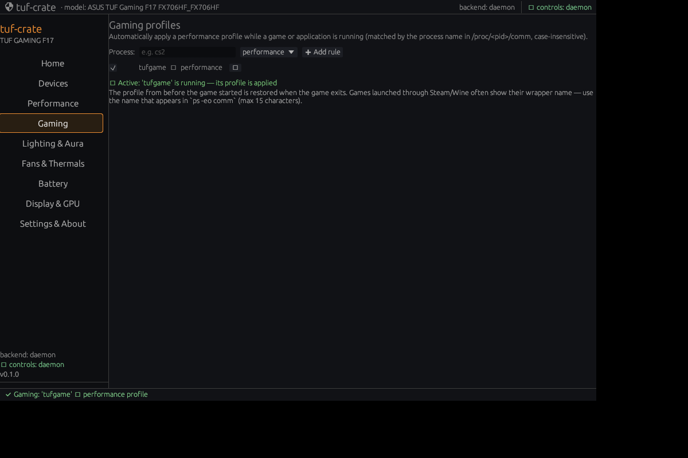

# Gaming profiles — automatic performance profiles

Armoury Crate can switch performance modes per game. tuf-crate implements a
Linux-native equivalent that works entirely through the verified profile path.

## How it works

- Rules live in `~/.config/tuf-crate/game-profiles.json`.
- While tuf-crate is open, the process list is checked every 4 seconds
  (`/proc/<pid>/comm`, zombie processes are ignored).
- When an enabled rule matches, its `platform_profile` (quiet / balanced /
  performance) is applied through the normal daemon funnel and audited.
- When the process exits, the profile that was active before the game started is
  restored.

## Rule format

```json
[
  { "process": "cs2", "profile": "performance", "enabled": true },
  { "process": "kdenlive", "profile": "balanced", "enabled": false }
]
```

Matching is case-insensitive and exact against the kernel `comm` name (max 15
characters). Steam/Proton games may appear as a wrapper process — use the name
shown by `ps -eo comm` while the game is running.

## UI

**Gaming** tab → enter a process name, pick a profile, **Add rule**. Rules can be
disabled with the checkbox or deleted with ✕. The status line shows when a rule
is active and when the previous profile was restored.


