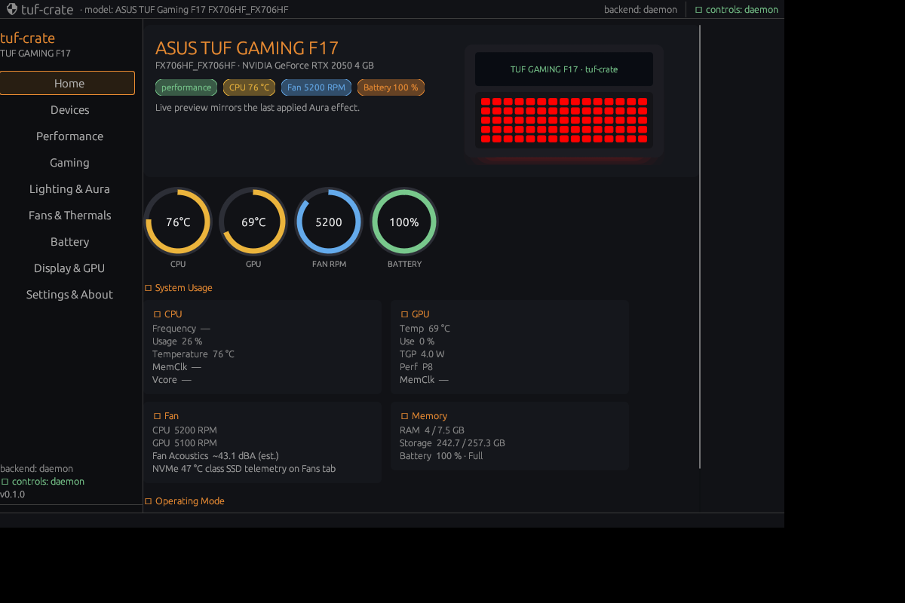
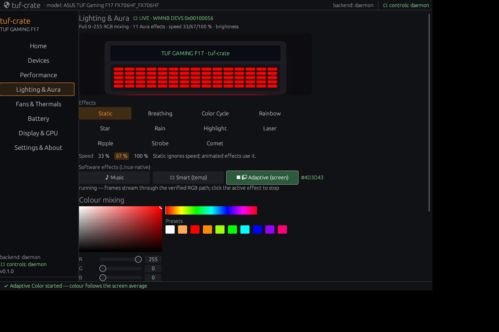

# Keyboard RGB — protocol, effects, speed and brightness

**Status: working on FX706HF (BIOS 312, kernel 7.2.11).** Verified live from Linux through
the upstream `asus-wmi` interface — no EC poking, no AsIO, no vendor drivers.

## Interface

```
/sys/class/leds/asus::kbd_backlight/kbd_rgb_mode    (write-only)
  <cmd> <mode> <r> <g> <b> <speed-index>

  cmd         1 = 0xb4 ("set"), 0 = 0xb3
  mode        0..11 (see table; 9 and >=12 are mapped to 10 by the kernel)
  r/g/b       0..255 each — arbitrary mixing
  speed-index 0 = 33 %, 1 = 67 %, 2 = 100 %  (kernel maps to 0xe1/0xeb/0xf5)
```

The kernel `asus-wmi` driver issues:

```
WMNB DEVS(0x00100056, 0xb4 | mode<<8 | R<<16 | G<<24, B | speed<<8)
```

and requires the keyboard power-state command first:

```
/sys/class/leds/asus::kbd_backlight/kbd_rgb_state
  <cmd> <boot> <awake> <sleep> <shutdown>     e.g. "1 1 1 0 0"
```

Without the state command the firmware acknowledges effect modes but renders them static.
tuf-crate sends `1 1 1 0 0` before every RGB apply (idempotent, same value G-Helper uses).

Brightness is independent and lives on the LED class:

```
/sys/class/leds/asus::kbd_backlight/brightness   0..3   (0 %, 33 %, 66 %, 100 %)
```

## Effects

| Mode | Name | Animation | Colour behaviour (observed) |
|---|---|---|---|
| 0 | Static | solid | picker colour (verified) |
| 1 | Breathing | pulse; speed applies | picker colour (verified) |
| 2 | Color Cycle | hue sweep | full spectrum by design |
| 3 | Rainbow | animated rainbow | full spectrum by design (verified) |
| 4 | Star | twinkle | firmware renders multicolour |
| 5 | Rain | falling drops | firmware renders multicolour |
| 6 | Highlight | travelling band | firmware renders multicolour |
| 7 | Laser | sweeping beam | firmware renders multicolour |
| 8 | Ripple | expanding ripples | firmware renders multicolour |
| 10 | Strobe | fast flashing | picker colour (flash verified) |
| 11 | Comet | comet + tail | firmware renders multicolour |

**Important honesty note:** on this single-zone keyboard several effect modes are
multi-colour in firmware and do not follow the picker. Their visual differences are mostly
temporal (movement/rhythm) and can look similar in a quick glance. Static, Breathing and
Strobe are the colour-controlled modes; the rest are spectrum or firmware-rendered
multi-colour effects.

Mode 12 ("Flash") is not exposed: the kernel sanitises >= 12 to Strobe. Music / Smart /
Adaptive / AI effects are Armoury-Crate-side rendering features with no firmware hook on
this model.

## Software effects (Linux-native)

Armoury Crate renders Music / Smart / Adaptive Color in its Windows engine; this project
implements Linux-native equivalents in the Lighting tab. All of them stream **Static
(mode 0)** frames through the normal verified `set_kbd_rgb` path.

### Music (audio-reactive)

- `pw-record --target auto -P stream.capture.sink=true` captures the **default output**
  (sink monitor) at 16 kHz mono s16.
- A VU-style RMS level (fast attack / slow release) and a simple beat detector (level vs
  a 0.4 s energy history) are computed in a background thread; beats trigger a
  full-brightness flash.
- The GUI derives a colour from the picker hue + level (brightness 8–100 %, small hue
  shift) and streams frames at most ~12 frames/s, only when the colour changes.

### Smart (CPU temperature)

- Colour follows the CPU package temperature: blue ≤ 45 °C → green ~60 °C → amber ~75 °C
  → red ≥ 85 °C. Updated twice per second.

### Adaptive Color (screen average)

- Samples the screen with ImageMagick (`import -window root -resize 1x1!`) once per
  second and applies the average colour at a 30 % brightness floor. Requires an X11
  display (XWayland is fine); reports a clear error otherwise.

All three stop when the GUI closes, when the active effect is clicked again, or when any
hardware effect is selected. Every frame is a normal validated, audited RGB write (rate
limited by the change threshold).

Every frame goes through the same validated, capability-gated, audited funnel. Because the
frames are real writes, each one is recorded in the audit log (rate-limited by the change
threshold); the effect is fully reversible (stop it or pick a static colour).

Verified end-to-end headlessly with a 440 Hz tone: the level meter climbed and the audit
log recorded the frame sequence (e.g. `1 0 33 1 0 1` → `1 0 101 25 0 1` → `1 0 159 69 0 1`).






## Verification

| Check | Evidence |
|---|---|
| DEVID present | `DSTS(0x00100056)` = `0x00010000` |
| Static colour | red, green, blue, amber, violet (128,0,255) visibly confirmed |
| Colour mixing | arbitrary 0–255 RGB confirmed (violet) |
| Breathing | 33 % = slow pulse; 100 % = visibly faster pulse |
| Color Cycle | hue sweep confirmed |
| Rainbow | cycling confirmed |
| Star | twinkling confirmed |
| Rain | falling drops/streaks confirmed |
| Highlight | travelling band confirmed |
| Laser | sweeping beam confirmed (multicolour rendering) |
| Ripple | expanding ripples confirmed |
| Strobe | rapid flashing confirmed |
| Comet | moving comet with tail confirmed |
| Speed mapping | 33/67/100 visually distinct (33 slow vs 100 fast); kernel indices 0/1/2 |
| Brightness | LED levels 0–3 verified earlier |

All 11 firmware effect modes were applied to the physical keyboard and observed by the
owner. The firmware renders several effects in multi-colour regardless of the base colour
(e.g. Laser); the picker colour still controls Static/Breathing and the tint of others.

## Safety

- Only the two documented kernel attributes above are written.
- Values are validated (five/six components, each 0–255); the kernel validates mode/speed.
- No EC register access, no SMI invocation, no AsIO/ATKACPI, no firmware changes.
- Reversible: send any colour/effect again; state is volatile and resets on reboot.

## Implementation map

- `crates/tuf-core` — `VerifiedAttr::KbdRgb` (closed-enum safety boundary)
- `crates/tuf-hal` — `set_kbd_rgb()`: prefers `kbd_rgb_mode`, writes `kbd_rgb_state`,
  converts the UI speed to the kernel index, audits every write; `tuf_rgb.ko` fallback
- `crates/tuf-daemon` — `set_kbd_rgb` op over the local socket
- `crates/tuf-gui` — Lighting tab: 11 effects, speed chips, saturation/value square, hue
  strip, RGB sliders, HEX, presets, animated original-art keyboard preview, local profiles,
  brightness levels


