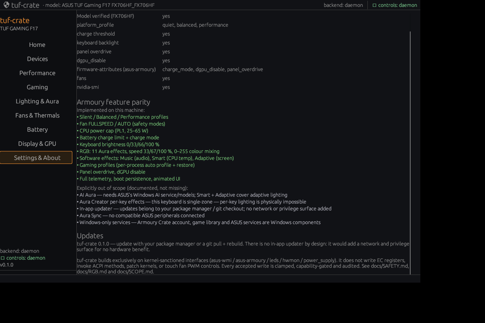

# Armoury Crate parity — scope and definition of done

**Principle: implement every feature this laptop's firmware/hardware exposes; exclude
only what is physically impossible or belongs to ASUS's Windows-only services — and say
so explicitly.**

## Implemented on FX706HF

| Area | Feature | Interface / evidence |
|---|---|---|
| Performance | Silent / Balanced / Performance profiles | `platform_profile` |
| Cooling | Fan FULLSPEED / AUTO, monitoring | asus hwmon `pwm*_enable`, `fan*_input` |
| Power | CPU PL1 cap 25–65 W | `intel-rapl` constraint_0 |
| Battery | Charge limit, charge mode, health | `charge_control_end_threshold`, `charge_mode` |
| Keyboard | Brightness 0/33/66/100 % | `asus::kbd_backlight` |
| Keyboard RGB | **11 Aura effects**, speed 33/67/100 %, **arbitrary 0–255 mixing**, all visually verified | `kbd_rgb_mode` + `kbd_rgb_state` (WMNB DEVS 0x00100056) |
| RGB software effects | **Music** (audio-reactive, pw-record + beats), **Smart** (CPU temperature), **Adaptive Color** (screen average) | streamed Static frames through the verified path |
| Gaming | **Per-game auto profiles** (process name → profile, auto-restore) | `/proc/<pid>/comm` → `platform_profile` |
| Display/GPU | Panel overdrive, dGPU disable | `panel_od`, `dgpu_disable` |
| Persistence | Profile / PL1 / fan mode re-applied at boot | `tuf-crated` boot config |
| UI | Armoury-style tabs, animated original-art keyboard preview, colour mixer, screenshots | `crates/tuf-gui`, `docs/images/` |

All of the above are clamped, capability-gated and audited (`docs/SAFETY.md`).

## Explicitly out of scope (closed, with reasons)

| Item | Why it is closed |
|---|---|
| **AI Aura** | Armoury Crate's AI effect requires ASUS's Windows AI service and models. There is no firmware hook and no Linux equivalent. Smart (CPU-temperature) and Adaptive Color (screen) cover adaptive lighting natively. |
| **Aura Creator per-key effects** | The FX706HF keyboard is **single-zone**: the firmware accepts one colour/effect at a time. Per-key lighting is physically impossible on this hardware. |
| **In-app updater** | Updates belong to the OS package manager or the git checkout. An in-app updater would add network + privilege surface with no hardware benefit; deliberately excluded. |
| **Aura Sync** | No compatible ASUS Aura peripherals are connected; there is nothing to synchronise. |
| **Windows-only services** | Armoury Crate account, game library integration, ASUS service management and crash reporting are Windows components, not hardware features. |
| **Fan curves / manual PWM / WMI PPT / Dynamic Boost** | Rejected by this model's firmware or unsafe (documented in `docs/UNSUPPORTED.md`). |

## Definition of done

A feature is "done" when (1) it has a documented kernel-sanctioned interface, (2) it is
implemented behind the `VerifiedAttr` safety funnel, (3) it has fixture tests, and (4)
it has been exercised on the physical machine (or headlessly end-to-end where no visual
output exists). Features that fail (1) are closed here instead of being faked.

The About tab in the GUI shows this same parity list and the update policy.

