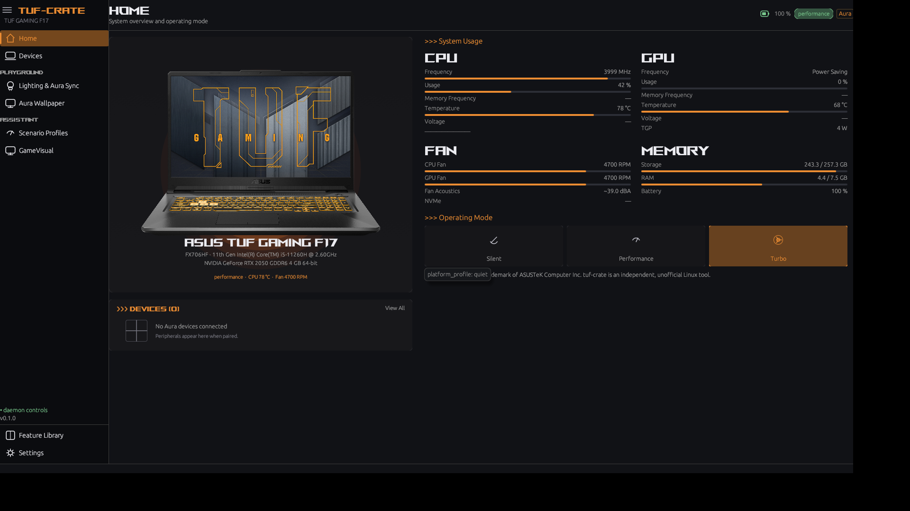
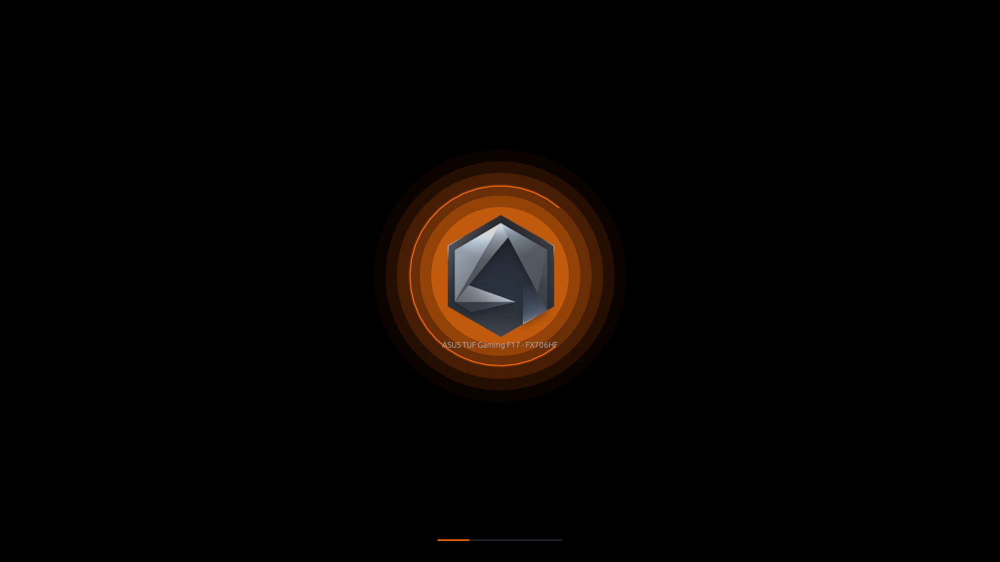
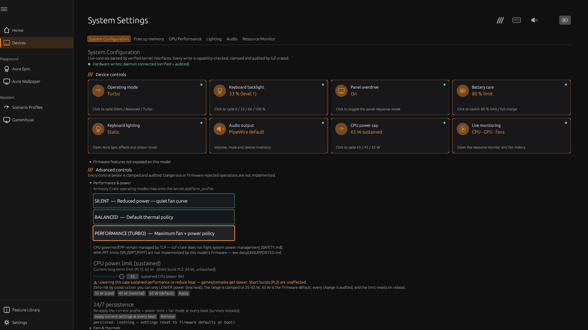
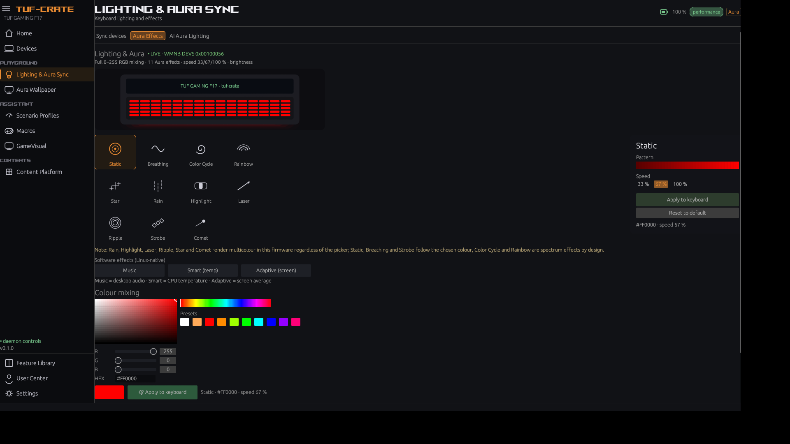
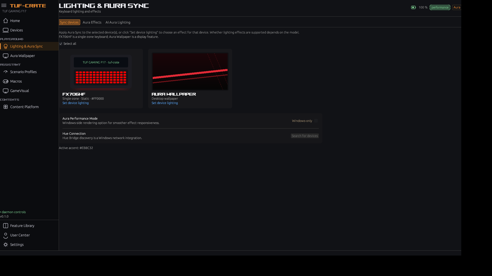
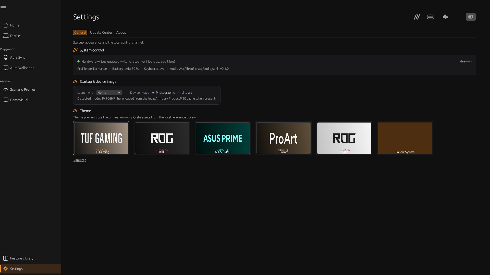

# Armoury Crate UI/UX recreation — design & technical decisions

## Frontend decision: keep egui/eframe

Assessed against the fidelity requirements (custom layout, images, fonts, animation,
textures, responsive content):

| Option | Assessment |
|---|---|
| **egui/eframe (chosen)** | Already hosts the Rust HAL/daemon; supports custom painting, gradient meshes, image textures (`image` crate), custom font families, 60 fps UI; we reached the Armoury shell/Hierarchy/Home/Effects layout without replacing the stack. |
| Qt/QML | Best styling fidelity, but a full rewrite of every screen and a second UI stack (C++/QML bindings), delaying the hardware work and duplicating state. |
| GTK4/libadwaita | Strong native integration but a different visual language; Armoury-specific cards/icons would still be custom-drawn. |
| Tauri + web | CSS would ease layout, but adds a webview/JS runtime, IPC bridge and a larger attack surface for a privileged-control app. |

Decision: **stay on egui**, invest in design tokens, custom widgets, local assets and font
loading. Revisit only if Lottie/SVG playback becomes a hard blocker.

## Design system

- Background `#111216`, sidebar `#0B0C0F`, cards `#18181B`/`#1E1E20`, text `#EBEBF0`,
  muted `#8A8A90`.
- Accent is theme-driven (TUF orange `#EB8C32`, ROG red, PRIME blue, ProArt gold, light
  mode) through a shared `accent()` token used by every custom-painted widget.
- Page, sidebar, card, meter and text colours are tokenised too: the **light theme** flips
  the whole shell/cards/typography (verified headlessly), while Follow System currently
  maps to the dark palette until a desktop colour-scheme API is used.
- Typography: **ROGFonts-Regular** (local vendor asset) for page titles, section headings,
  CPU/GPU/Fan/Memory labels, brand and the device name; default sans for body text —
  matching Armoury's mixed hierarchy. Font family falls back safely when the asset is
  absent.
- Components: icon sidebar with group headers, page title bar, product card, status chips,
  meter bars, ring gauges, effect tiles + detail panel, mode cards, theme cards, toasts
  (status bar), confirmation gates.

## Asset pipeline

`assets/vendor-reference/` (gitignored) is populated by a documented read-only extraction
from the Windows install; `manifest/assets-manifest.json` holds SHA-256/size/dimensions.
The app loads:

- `branding/AC_Logo.png` for the splash,
- `fonts/ROGFonts-Regular.ttf` for the display family,
- `themes/ac_settings_img_*.png` for the six theme cards,
- `wallpapers/` (vendor) plus the redistributable `assets/wallpapers/` originals.

The hero laptop photograph was recovered from the UWP app's `LocalState\ProductPNG`
cache (`90NR0HC4-M003D0_crop.png`) and is loaded automatically for the detected model
(`FX706HF`); the vector laptop is only a fallback when the local asset is absent.

## Animation & interaction

- Splash: logo entrance/fade, orange glow, rotating accent ring, progress line (native
  recreation of the Lottie splash; durations matched to the reference).
- Live device preview: per-key RGB animation in the Lighting tab, Home hero and Sync
  devices card.
- Gauge easing on Home; hover states on nav, effect tiles, cards and theme previews.
- Software effects stream frames (Music/Smart/Adaptive) with beat flashes.
- Page transitions, card lift and toast animations are next (see UI-GAP remaining work).

## Current screens (screenshots)

