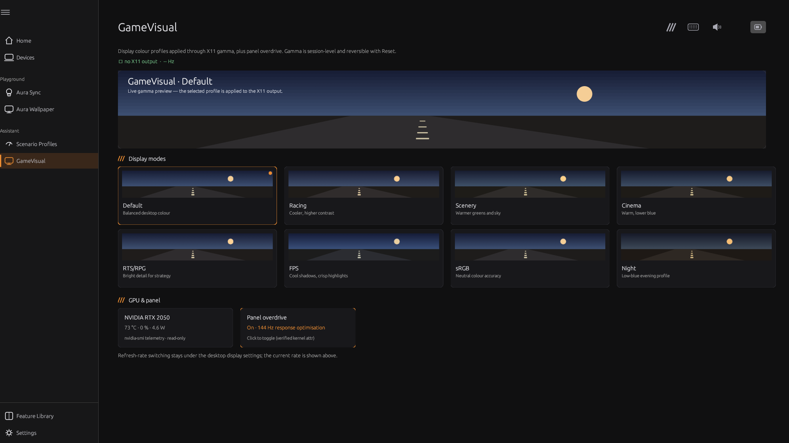
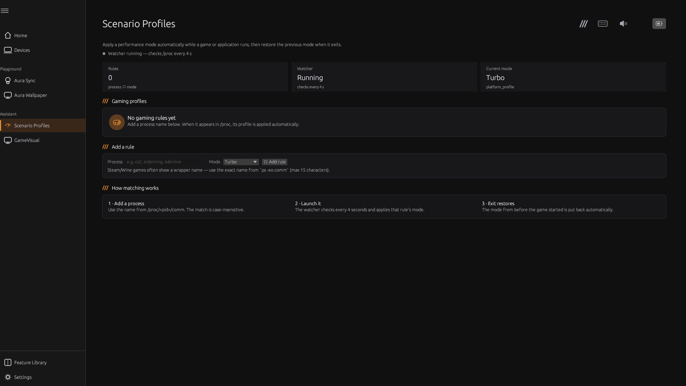
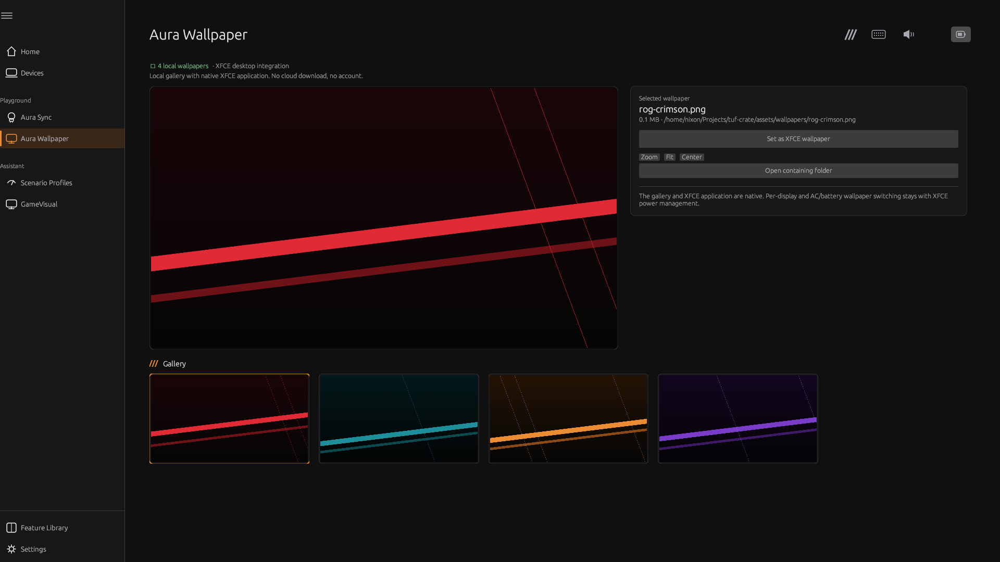
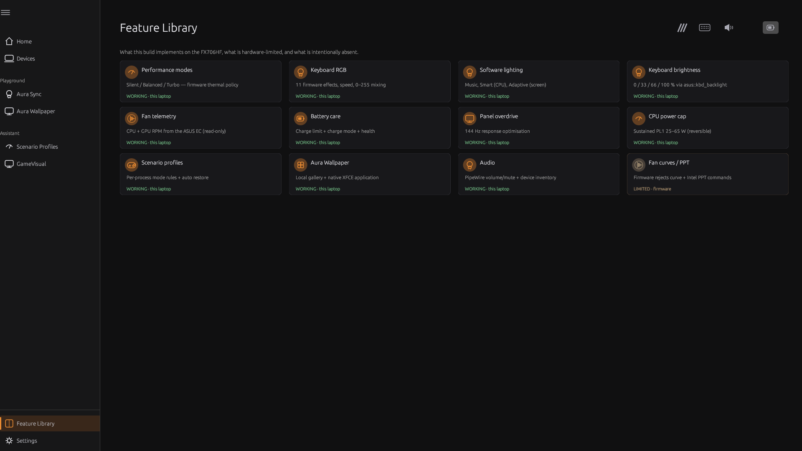

# Armoury Crate UI/UX recreation — design & technical decisions

## Frontend decision: keep egui/eframe

Assessed against the fidelity requirements (custom layout, images, fonts, animation,
textures, responsive content):

| Option | Assessment |
|---|---|
| **egui/eframe (chosen)** | Already hosts the Rust HAL/daemon; supports custom painting, gradient meshes, image textures (`image` crate), custom font families, 60 fps UI; we reached the Armoury shell/Hierarchy/Home/Effects layout without replacing the stack. |
| Qt/QML | Best styling fidelity, but a full rewrite of every screen and a second UI stack (C++/QML bindings), delaying the hardware work and duplicating state. |
| GTK4/libadwaita | Strong native integration but a different visual language; Armoury-specific cards/icons would still be custom-drawn. |
| Tauri + web | CSS would ease layout, but adds a webview/JS runtime, IPC bridge and a larger attack surface for a privileged-control app. |

Decision: **stay on egui**, invest in design tokens, custom widgets, local assets and font
loading. Revisit only if Lottie/SVG playback becomes a hard blocker.

## Design system

- Reference palette: page `#101011`, sidebar `#171718`, cards `#16161A`/`#1A1A1D`,
  text `#EBEBF0`, muted `#8A8A90`; selected sidebar rows use a warm translucent fill with a
  thin accent rail instead of a solid orange row.
- Accent is theme-driven (TUF orange `#EB8C32`, ROG red, PRIME blue, ProArt gold, light
  mode) through a shared `accent()` token used by every custom-painted widget.
- Page, sidebar, card, meter and text colours are tokenised too: the **light theme** flips
  the whole shell/cards/typography (verified headlessly), while Follow System currently
  maps to the dark palette until a desktop colour-scheme API is used.
- Typography: the regular UI face for page titles, section headings, System Usage labels
  and body text; **ROGFonts-Regular** (local vendor asset) for the device name and accent
  wordmarks. Font family falls back safely when the asset is absent.
- Components: icon sidebar with Playground/Assistant group headers, page title + reference
  header glyphs, borderless Home hero, outlined Devices card, System Usage row grid,
  Operating Mode cards, effect tiles + detail panel, theme cards, toasts, confirmation gates.
- Layout: tuned against the Windows reference at 1920×1000 (hero at 262–466 px, Devices
  card at ~763 px, Fan/Memory row at 547 px, Operating Mode cards at 850–972 px). At larger
  heights the Devices card grows and Operating Mode anchors to the bottom; at 1366×768 the
  page scrolls with a visible scrollbar. Page/sub-tab switches reset scroll to the top.
- Safety: dGPU Eco power-off is restore-only. Live `dgpu_disable=1` froze the compositor on
  this EC and is blocked; the app explains it and records the incident in SAFETY.md.

## Asset pipeline

`assets/vendor-reference/` (gitignored) is populated by a documented read-only extraction
from the Windows install; `manifest/assets-manifest.json` holds SHA-256/size/dimensions.
The app loads:

- `branding/AC_Logo.png` for the splash,
- `fonts/ROGFonts-Regular.ttf` for the display family,
- `themes/ac_settings_img_*.png` for the six theme cards,
- `wallpapers/` (vendor) plus the redistributable `assets/wallpapers/` originals.

The hero laptop photograph was recovered from the UWP app's `LocalState\ProductPNG`
cache (`90NR0HC4-M003D0_crop.png`) and is loaded automatically for the detected model
(`FX706HF`); the vector laptop is only a fallback when the local asset is absent.

## Animation & interaction

- Splash: logo entrance/fade, orange glow, rotating accent ring, progress line (native
  recreation of the Lottie splash; durations matched to the reference).
- Live device preview: per-key RGB animation in the Lighting tab, Home hero and Sync
  devices card.
- Gauge easing on Home; hover states on nav, effect tiles, cards and theme previews.
- Software effects stream frames (Music/Smart/Adaptive) with beat flashes.
- Page transitions, card lift and toast animations are next (see UI-GAP remaining work).

## Current screens (screenshots)

